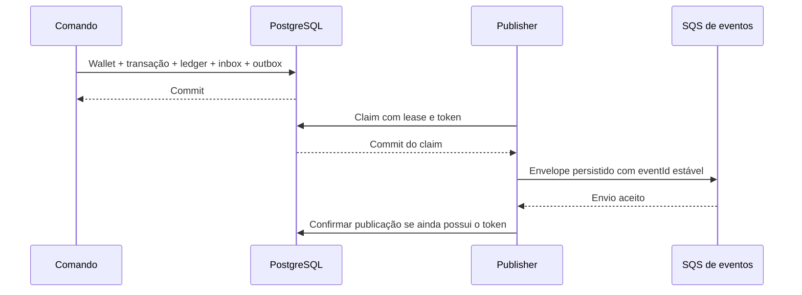

# Arquitetura

## Objetivo e fronteiras

Wallet Ledger Lab estuda como preservar um saldo auditável quando comandos chegam duplicados, fora de ordem ou por processos concorrentes. O domínio de apostas é simulado; este código não integra pagamentos, contas bancárias ou provedores reais.

A implementação é um monólito modular com processos configuráveis para API e workers. HTTP e SQS chamam o mesmo `FinanceService`. O domínio não importa NestJS ou TypeORM; adaptadores traduzem contratos de transporte e registros de persistência para os objetos de domínio.

| Camada | Responsabilidade |
| --- | --- |
| `src/domain` | Dinheiro, wallet, transições, lançamentos, inbox/outbox e eventos |
| `src/application` | Caso de uso, transação SQL, referências e replay |
| `src/infra` | Mapeamento TypeORM, migrations, SQS e telemetria |
| `src/transport` | Contratos HTTP, validação e ponto de extensão de identidade |
| `src/workers` | Consumo de entrada, referências pendentes e publicação da outbox |

O build usa Bun 1.4.4 e mantém dependências externas ao bundle. A imagem de runtime executa `dist/main.js`; a imagem de verificação inclui ferramentas de desenvolvimento. As versões e o lockfile identificam o ambiente reproduzível, sem transformá-lo em evidência de compatibilidade com qualquer outro runtime.

## Persistência e escolha do ORM

TypeORM foi escolhido para manter o mapeamento em `EntitySchema`, separado das classes de domínio, e tornar explícitas as operações de concorrência e persistência. `Database.transaction` fornece um `EntityManager` na mesma transação e conexão; o caso de uso usa locks pessimistas por wallet. `QueryRunner` aparece nas migrations e nos controles de transação dos testes de infraestrutura. SQL específico fica visível onde são necessários claim com `SKIP LOCKED`, fencing por token e constraints diferidas.

MikroORM também atenderia ao problema com Unit of Work e locks; a escolha de TypeORM não pressupõe uma limitação daquele ORM. O trade-off aqui é manter conversões e parte das consultas de forma manual. Isso exige testes reais do driver, das constraints e dos resultados das queries. Não há um segundo ORM nem sincronização automática de schema: migrations versionadas são a fonte de alterações estruturais.

O PostgreSQL armazena `balance`, `amount`, `balance_before`, `balance_after` e `result_balance` em colunas `numeric(38,2)`, com moeda em coluna separada. O driver entrega esses valores como strings; os adaptadores não os convertem para `number`. `src/infra/entities.ts` declara o mapeamento, e `FinanceService` converte entre registros e objetos de domínio explicitamente.

Ao restaurar uma wallet ou transação, o adaptador constrói `Money` com a factory apropriada e chama `Wallet.rehydrate` ou `WagerTransaction.rehydrate`, sem executar novamente abertura, débito ou transições. Os saldos e valores de operações persistidos são não negativos; `Money.rehydrate` também admite valores assinados internos, como o saldo reconstruído na reconciliação. Não há tipo monetário do ORM ou decorator de persistência no domínio.

## Dinheiro e identidade

`Money` encapsula uma configuração privada de `decimal.js`, com precisão de 80 dígitos. O contrato admite até 36 dígitos inteiros e exatamente duas casas decimais, dentro de `numeric(38,2)`. Entrada e saída são strings; nenhum cálculo financeiro usa `number`.

Entradas com expoente, sinal, espaços, valores não finitos ou escala diferente são recusadas. A implementação não arredonda entradas. Operações internas podem produzir valores negativos para deltas e reconciliação; os contratos públicos não os aceitam. Uma operação não mistura moedas.

As moedas são códigos de três letras maiúsculas reconhecidos pelo catálogo ICU do Bun fixado, incluindo códigos históricos reconhecidos. Todas usam duas casas neste laboratório. Isso é uma simplificação explícita do modelo, não uma implementação completa das regras monetárias de cada moeda.

Wallets são únicas por jogador e moeda. IDs internos, identidade do jogador e identificadores externos têm funções distintas: a referência de uma operação aponta para o ID externo dentro do mesmo provedor.

## Unidade de concorrência e commit

Cada comando financeiro executa em uma transação PostgreSQL `READ COMMITTED`. A aplicação obtém `SELECT FOR UPDATE` na linha da wallet antes de consultar replay, avaliar referências e alterar saldo. Processos diferentes disputam a mesma linha; wallets diferentes não dependem de um lock global.

O fluxo de aceite é:

1. Validar e normalizar o contrato.
2. Obter o lock da wallet.
3. Consultar inbox e idempotência persistidas.
4. Avaliar a operação e suas referências.
5. Gravar transação, saldo, ledger, inbox e eventos da outbox.
6. Confirmar o commit.
7. Retornar o resultado; no consumidor SQS, só então fazer ack.

O lock tem espera limitada. Erros previstos de concorrência recebem retry limitado; cada tentativa restaura um novo objeto de domínio para não reutilizar uma transição de uma transação SQL revertida.

A versão começa em 1, inclusive na abertura com saldo positivo, e aumenta somente quando uma operação posterior muda o saldo. `LOSS` e rejeições não aumentam a versão. Abertura positiva tem uma transação interna `OPENING` e um lançamento de crédito; abertura zero não movimenta o ledger.

## Garantias no schema

O banco valida o resultado no commit, além das regras executadas em TypeScript.

| Invariante | Proteção |
| --- | --- |
| Wallet única por jogador/moeda | Constraint de unicidade |
| Saldo finito e não negativo | Tipo decimal e constraints explícitas |
| Chave financeira global e operação externa únicas | Índices de unicidade |
| Transporte deduplicado | Chave composta de inbox por consumidor e mensagem |
| Um lançamento por wallet/transação | Constraint de unicidade |
| Ledger e auditoria financeira preservados | Triggers contra alteração e remoção indevidas |
| Direção e aritmética do lançamento | Constraints e triggers diferidos |
| Saldo igual à soma dos lançamentos | Validação diferida de reconciliação |
| Histórico contínuo | Conferência dos saldos antes/depois e versões consecutivas |
| Referência no mesmo escopo | Chave estrangeira composta e regras de transição |
| Reversão única por tipo | Índice parcial sobre referência e kind processado |
| Resultado financeiro terminal consistente | Validação de estado, ledger, identidade e referência |

As migrations são versionadas e reversíveis. Testes de reversão usam schemas isolados; a reversibilidade de DDL não torna uma restauração de dados ou um downgrade operacional automaticamente seguro.

Este ledger registra movimentos de uma wallet. Não implementa contabilidade de partidas dobradas, contas de liquidação ou reconciliação com instituições externas.

## Idempotência e resultado histórico

HTTP exige `Idempotency-Key`; SQS transporta a chave dentro de `data`. A unicidade é global. A dupla de provedor e ID externo também é única, impedindo reaplicação com outra chave.

O hash financeiro usa SHA-256 sobre JSON canônico: chaves de objetos ordenadas recursivamente, arrays preservados e valores monetários normalizados. Entram os campos de negócio, incluindo referência quando presente. A chave de idempotência e os metadados de transporte ficam fora desse hash.

Um replay devolve a mesma transação, decisão e saldo observado na decisão original. Ele não recalcula o resultado com base no saldo atual. Chave igual e payload diferente geram conflito.

Inbox usa o ID do envelope da aplicação, não o ID atribuído pelo SQS. Seu hash cobre `data` normalizado, incluindo a chave recebida nesse contrato. Reutilizar o mesmo ID de mensagem com conteúdo divergente é um conflito de transporte; ele não substitui a auditoria original.

## Referências e estados

`PENDING` e `PENDING_REFERENCE` são estados não terminais. A partir deles, uma operação pode ser processada, rejeitada ou marcada como falha permanente. `PROCESSED`, `REJECTED` e `FAILED` são terminais.

Referências pertencem ao mesmo provedor, jogador, wallet, moeda e rodada. `REFUND` exige uma `BET` processada; `ROLLBACK` aceita `BET`, `WIN` ou `REFUND` processadas. Reversões são integrais. A unicidade é por tipo: uma `REFUND` e uma `ROLLBACK` sobre a mesma `BET` podem coexistir. Esse comportamento precisa ser entendido antes de reutilizar o domínio em outro contexto.

Uma referência ausente ou ainda não terminal deixa a operação pendente. O worker aplica backoff, limite de tentativas e TTL; ao esgotar o orçamento, persiste rejeição e evento. Uma referência terminal inválida é rejeitada sem movimento financeiro. A [especificação](docs/SPECIFICATION.md) registra os códigos públicos.

## Inbox, outbox e entrega

A transação financeira inclui a inbox, quando aplicável, e os eventos da outbox. Nenhuma publicação de evento ocorre dentro dessa transação aberta.

Publishers concorrentes fazem claim em uma transação curta com `FOR UPDATE SKIP LOCKED`, lease e token de posse. Após o commit do claim, enviam o envelope persistido. Só o token ainda válido pode confirmar publicação ou agendar retry. A lease é renovada durante a chamada ao broker e expira se o processo morrer.

Se o processo morrer após o envio e antes da confirmação no banco, outro publisher pode reenviar o mesmo evento. A semântica é `at-least-once`: consumidores de saída precisam deduplicar por `eventId` em armazenamento persistente. A janela de deduplicação FIFO é uma otimização, não a garantia principal. Não há ordem total adicional entre publishers ou entre todos os tipos de evento.

Falhas de publicação geram retry com backoff, sem descarte automático de eventos confirmados no SQL. A idade e a quantidade de eventos pendentes são visíveis na telemetria.

## Consumo e encerramento

O consumidor renova a visibilidade durante o processamento. Rejeições financeiras persistidas recebem ack; contratos inválidos e conflitos permanentes seguem para a DLQ. Falhas transitórias respeitam um orçamento de entregas reais, não uma contagem de polls.

Quando o orçamento termina e o banco está disponível, o serviço grava `FAILED` e `WagerTransactionFailed` antes da DLQ/ack. Se o banco permanecer indisponível, a redrive policy pode encaminhar a mensagem sem registro SQL. Nesse caso, a DLQ é a evidência operacional e exige investigação antes de qualquer reenvio.

O poll de entrada espera até um segundo. Essa escolha aumenta requisições ociosas e permite drenar um receive normal dentro do orçamento de shutdown. Em `SIGTERM`, o consumidor interrompe novos ciclos, espera o poll, devolve recibos recebidos durante a parada e tenta concluir trabalho em andamento. Abort é fallback após o prazo de drain, com tempo reservado à devolução de visibilidade. O prazo interno deve permanecer menor que a tolerância do orquestrador.

## Identidade local e desenho futuro

A autenticação foi adiada para concentrar este laboratório em consistência financeira. O estado implementado é explícito: `ProviderAuthGuard` chama `ProviderIdentityPort`, e `LocalProviderIdentity` autoriza a execução local sem autenticar um usuário. Isso não constitui autorização de produção. As portas publicadas ficam no loopback, e somente dados sintéticos devem ser utilizados.

O desenho futuro usaria um IdP externo compatível com OIDC, sem uma tabela própria de senhas. O adaptador verificaria assinatura do access token com as chaves JWKS do issuer configurado, algoritmos permitidos, `issuer`, `audience`, expiração e início de validade. Discovery e JWKS seriam obtidos de destinos configurados, com cache e atualização limitada; uma chave desconhecida ou validação malsucedida recusaria a requisição.

Após autenticar, a política de autorização relacionaria o principal aos provedores e recursos permitidos. `providerId`, `playerId` e `walletId` do corpo não seriam prova de autorização: uma consulta do lado do servidor precisaria confirmar vínculo e acesso à operação solicitada. O ponto de extensão atual permite substituir o adaptador local; a validação OIDC e essa política ainda não estão implementadas.

Os endpoints de liveness e readiness continuariam abertos. Métricas e ferramentas administrativas exigiriam os controles de rede e acesso definidos para o ambiente. SQS permaneceria um canal interno confiável, com produtores e consumidores autorizados por permissões da infraestrutura; não exigiria um JWT de usuário em cada mensagem. Os comandos ainda passariam pelas mesmas validações de contrato, identidade de domínio, moeda, referência e idempotência usadas na entrada HTTP.

## Observabilidade e limites

Logs JSON usam uma allowlist de nomes de campo, descartando campos não autorizados como `payload` e `password`. IDs operacionais podem aparecer nos registros; o filtro não é um redator geral do conteúdo das strings. O laboratório usa somente dados sintéticos e mantém logs brutos privados, fora dos artefatos públicos.

Contadores de respostas e retries são locais ao processo. Gauges consultam o estado persistido para contar transações por status, eventos pendentes e idade da outbox. Essas duas fontes medem coisas diferentes e não devem ser somadas como se fossem operações únicas.

Readiness verifica PostgreSQL e filas; liveness indica processo vivo. Prometheus e Grafana são ferramentas locais de inspeção. A [documentação de telemetria](docs/TELEMETRY.md) descreve consultas e validação.

A validação do histórico do ledger percorre os lançamentos da wallet; seu custo cresce com esse histórico. O projeto prioriza invariantes verificáveis e simplicidade. Não há benchmark de capacidade, SLO de produção, staging provisionado ou garantia de desempenho empresarial. A troca do adaptador de identidade permissivo por autenticação e autorização reais é necessária antes de qualquer exposição externa.

Resultados de testes e ferramentas pertencem ao [relatório gerado](evidence/latest/REPORT.md), não a uma contagem mantida manualmente neste documento.
