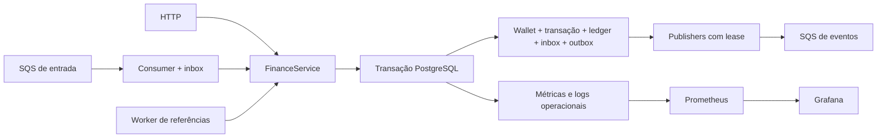

# Wallet Ledger Lab

**Um laboratório de correção financeira, concorrência e recuperação de falhas.**

[](evidence/latest/REPORT.md)

Wallet Ledger Lab é uma implementação do exercício público **Distributed Wagering Processor**, organizada como estudo de backend transacional por **Dri_Dev**. Usa Bun, NestJS, TypeScript, PostgreSQL, TypeORM e SQS local para explorar dinheiro exato, ledger imutável, idempotência persistente e entrega de eventos após commit.

Para avaliar a entrega, consulte o [mapa de requisitos e testes](docs/REQUIREMENTS.md), as [decisões de arquitetura](ARCHITECTURE.md) e as [evidências executadas](evidence/latest/REPORT.md). A origem pública do exercício e os limites da licença estão em [NOTICE.md](NOTICE.md).

Todos os cenários usam dados sintéticos. Não há clientes, dinheiro real, processamento de pagamentos ou uso empresarial demonstrado. O ambiente é local, com autenticação permissiva e portas vinculadas ao loopback.

## O que vale observar

- **Precisão:** valores monetários entram e saem como strings; `Money` usa `decimal.js` e colunas `numeric(38,2)`.
- **Concorrência:** locks por wallet e constraints PostgreSQL protegem saldo, versões e reversões entre processos independentes.
- **Auditoria:** cada alteração de saldo corresponde a um lançamento imutável, com continuidade do histórico verificada no banco.
- **Idempotência:** inbox e chaves financeiras persistidas impedem duplicação de efeitos, inclusive após reinício.
- **Recuperação:** outbox com lease e token de posse, retries, DLQ e testes com encerramento real de processos.



## Executar com Docker

É necessário Docker com Compose v2, capaz de executar containers Linux. Os comandos abaixo partem da raiz deste repositório; Bun não precisa estar instalado no host.

Prepare a configuração privada:

```sh
docker run --rm -v "${PWD}:/workspace" -w /workspace oven/bun:1.4.4 bun scripts/setup-local.ts
```

Esse formato de bind funciona no PowerShell e em shells POSIX. Se o shell não expandir `${PWD}` como caminho, use o caminho da pasta atual entre aspas. O setup gera credenciais locais em `.env`; esse arquivo não pertence ao pacote público.

Suba a aplicação e, opcionalmente, a observabilidade:

```sh
docker compose up --build -d --wait app
docker compose --profile observability up -d prometheus grafana
```

| Serviço local | Endereço |
| --- | --- |
| API | [localhost:3100](http://localhost:3100) |
| Liveness / readiness | [/health/live](http://localhost:3100/health/live) · [/health/ready](http://localhost:3100/health/ready) |
| Métricas | [/metrics](http://localhost:3100/metrics) |
| Grafana | [localhost:3101](http://localhost:3101) |
| Prometheus | [localhost:9091](http://localhost:9091) |

O acesso administrativo ao Grafana usa as credenciais geradas em `.env`. PostgreSQL e SQS da demonstração usam as portas locais `55442` e `4576`; testes usam `55443` e `4577`, com serviços separados.

Para parar preservando os volumes:

```sh
docker compose stop
```

## Verificar a implementação

```sh
docker compose --profile test run --build --rm tester
```

A verificação executa compilação, checagem de tipos, testes unitários e integração com PostgreSQL e LocalStack reais. Os cenários incluem requisições concorrentes em três processos, referências fora de ordem, falhas de publicação, entrega duplicada e recuperação após `SIGKILL` e `SIGTERM`.

O resultado atual pertence ao [relatório gerado](evidence/latest/REPORT.md), acompanhado de [resumo estruturado](evidence/latest/summary.json), JUnit e hashes dos artefatos. O badge reflete esse registro; não representa uma certificação externa. Consulte o relatório para identificar o código verificado, o ambiente, os comandos e eventuais falhas. A ausência de evidência gerada não significa aprovação.

O domínio conserva os nomes `BET`, `WIN`, `LOSS`, `REFUND` e `ROLLBACK`. Os contratos completos e exemplos de requisição estão na [especificação própria do laboratório](docs/SPECIFICATION.md).

## Explorar as decisões

| Documento | Conteúdo |
| --- | --- |
| [Estudo de caso](docs/CASE_STUDY.md) | Problema, decisões, evidências e limites |
| [Arquitetura](ARCHITECTURE.md) | Transação financeira, constraints, workers e trade-offs |
| [Especificação](docs/SPECIFICATION.md) | API, mensagens, regras e códigos de falha |
| [Operação local](docs/RUNBOOK.md) | Diagnóstico, reconciliação e recuperação |
| [Telemetria](docs/TELEMETRY.md) | Demonstração, consultas e limites das métricas |
| [Release](docs/RELEASE.md) | Artefato identificável, gates e recuperação planejada |
| [Segurança](SECURITY.md) | Limites do ambiente e publicação dos artefatos |

## Preparar o pacote de portfólio

Com Bun 1.4.4 disponível, execute:

```sh
bun run portfolio:package
```

O comando corresponde a `bun scripts/package-portfolio.ts --apply`. O resultado público fica em `artifacts/public/wallet-ledger-lab.zip`, acompanhado de manifesto e checksum. A seleção de arquivos é explícita: `.env`, histórico Git, dados locais e registros privados não devem entrar no pacote. Consulte [SECURITY.md](SECURITY.md) antes de compartilhá-lo.

## Autoria e proveniência

O desenvolvimento combinou assistência de IA, revisão de código e testes reproduzíveis; a metodologia e suas limitações estão no [estudo de caso](docs/CASE_STUDY.md). A implementação original deste repositório usa a [licença MIT](LICENSE). A inspiração pública e a separação dos direitos sobre o material de referência estão em [NOTICE.md](NOTICE.md).
